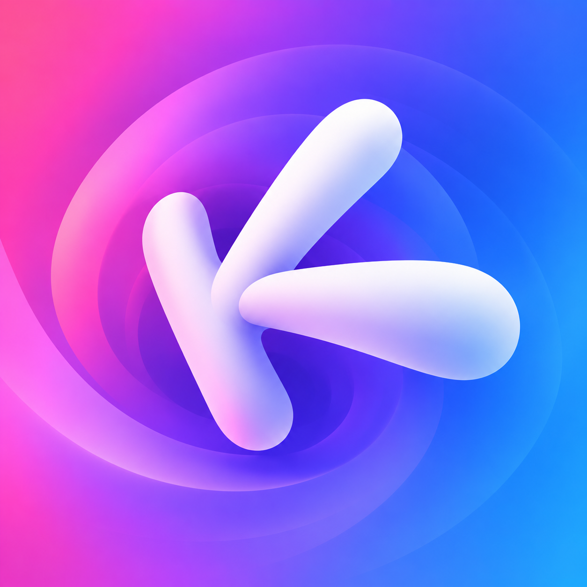
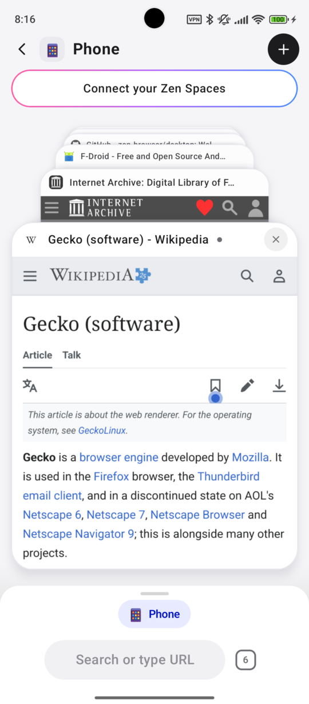
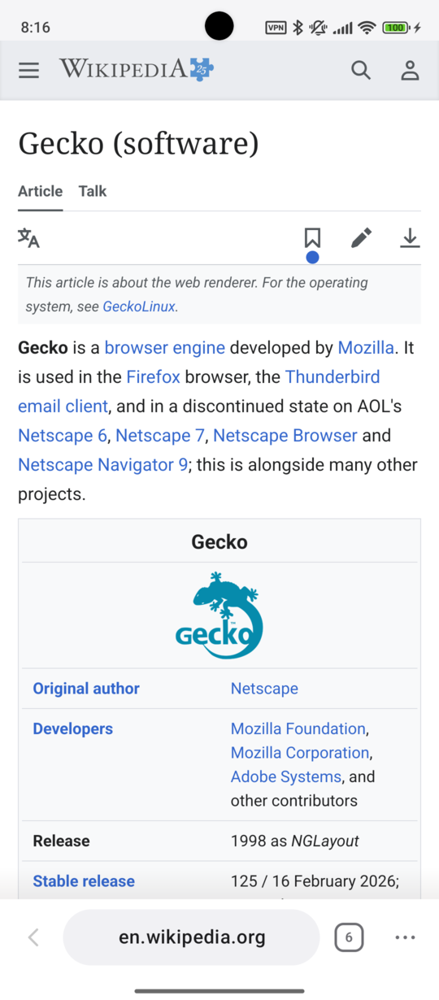
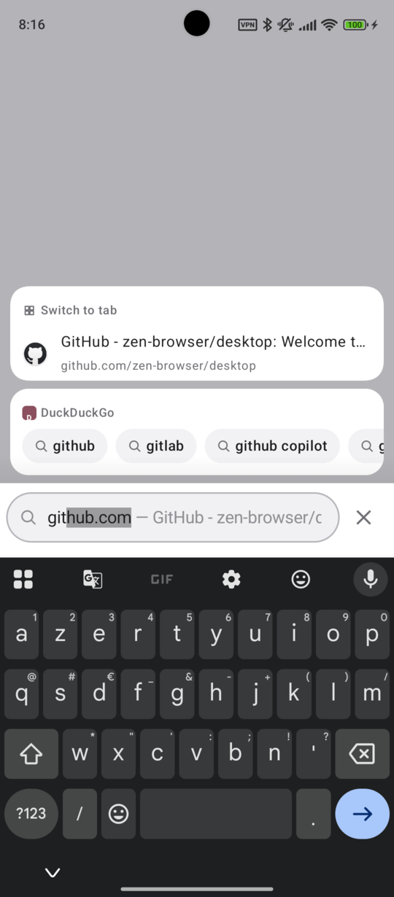
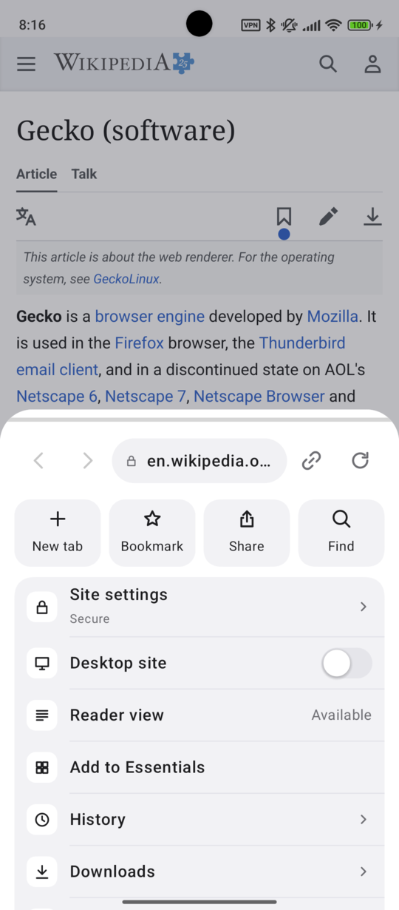
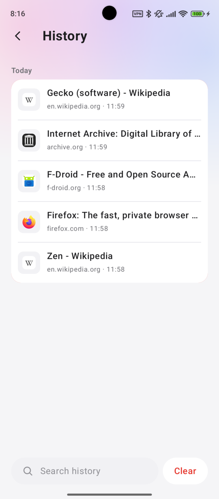
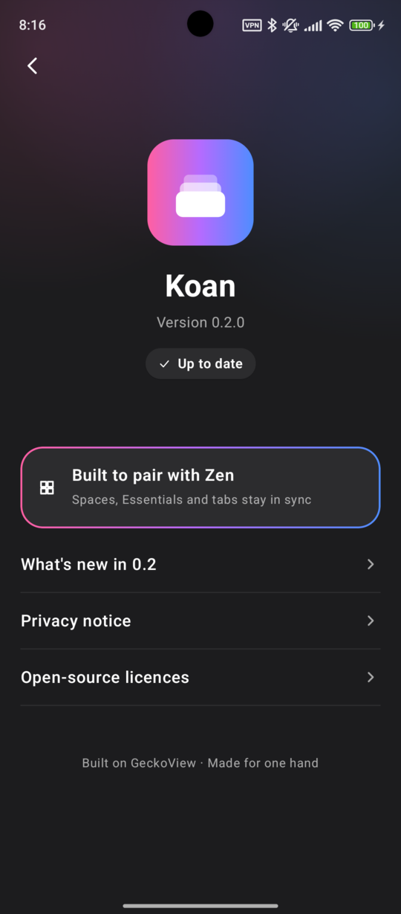

<p align="center"></p>

# Koan

A personal Android web browser built on **GeckoView** (Firefox's engine): a card stack of tabs
with depth, one-handed gestures, and workspaces that are your **Zen Browser Spaces**, synced
read-only from your Mozilla account: the same spaces, icons, colours, essentials, pinned tabs and
folders you have on the desktop.

> Not affiliated with, endorsed by or connected to Zen Browser or Mozilla.

**Beta: daily-driver ready, sync is read-only.**

- **What it can do, and how:** [`docs/FEATURES.md`](docs/FEATURES.md), the user guide.
- **What it sends, and to whom:** [`docs/PRIVACY.md`](docs/PRIVACY.md).
- **Download:** the latest APK is on the [releases page](https://github.com/Nerzouille/Koan/releases/latest);
  what changed is in [`CHANGELOG.md`](CHANGELOG.md).
- **Updates:** install with [Obtainium](https://github.com/ImranR98/Obtainium) from the GitHub
  releases (add `https://github.com/Nerzouille/Koan`) to get new versions automatically.

## Highlights

- **Your Zen Spaces** as workspaces, with their essentials, pinned tabs and folders in a drawer.
- **A card stack of tabs** with depth; swipe the dock up for it, sideways for the next tab,
  long-press the address pill to switch space.
- **Dock long presses:** back lists the pages before this one, the tab count opens New tab /
  Close tab, ⋯ opens Settings, History (in the overview) opens Recently closed.
- **Recently closed:** the last 25 closed tabs come back in their space and place, with their
  history.
- **What pages ask, in Koan's style:** drop-down lists, date/time/colour pickers, alerts and
  prompts, site sign-in, pop-ups, printing.
- **Pages fit around the dock and the keyboard:** a page's bottom bar (chat field, cookie banner)
  sits on the dock and follows it as it hides; a field you type in shows right above the keyboard.
- Search with suggestions and `@` shortcuts, history and bookmarks from your account, passwords
  and autofill, downloads, find in page, reader view, uBlock Origin. Details:
  [`docs/FEATURES.md`](docs/FEATURES.md).

## Screenshots

| Tab overview | A page | Search |
|:---:|:---:|:---:|
|  |  |  |
| **⋯ menu** | **History** | **About (dark theme)** |
|  |  |  |

Taken on a fresh install without an account (one local space), so no Zen Spaces are shown.

## Status

A one-person hobby project, built for my own phone and shared as-is.

- Sideloaded only: no Play Store, no support. Issues and PRs may go unanswered.
- Android 11+ (minSdk 30): tested on Android 14; 11–13 are supported but less tested. 64-bit
  ARM (arm64-v8a) only.
- See [`docs/ROADMAP.md`](docs/ROADMAP.md) for what is done and what is planned.

## Feedback

Found a bug or have an idea? Open an issue:

- [Bug report](https://github.com/Nerzouille/Koan/issues/new?template=bug_report.yml): your phone model,
  Android version, Koan version (Settings > About Koan), what happened and how to make it happen again.
- [Feature request](https://github.com/Nerzouille/Koan/issues/new?template=feature_request.yml)

Please leave private things out of issues (account emails, real tabs, passwords).

## Sign-in and sync

- You sign in on **Mozilla's own accounts page**, shown in a WebView. Koan has no login form of
  its own.
- The resulting session and sync key are stored on the device, encrypted with a key held in the
  **Android Keystore**. They are never logged or sent anywhere else.
- Sign-in and sync only talk to **Mozilla's servers** (Mozilla accounts, the Sync token server and
  the Sync storage server it points to). There is no Koan server, no analytics and no telemetry.
  Pages and their favicons load from the websites themselves, as in any browser.
- Spaces are read from the `spaces` collection that Zen writes to Firefox Sync, using the protocol
  documented by [Z-Sync](https://github.com/Kjell6/Z-Sync).

### Caveat

To be allowed into Firefox Sync, the sign-in **identifies as Firefox desktop**. This is unofficial:
it can break whenever Mozilla changes something, and it may go against Mozilla's terms of service.
**Use it at your own risk**, ideally not with an account you can't afford to have trouble with.

Koan only reads: your Spaces, and your passwords, bookmarks and history. Writing back to Zen is
planned behind a setting that will be **off by default**, because a bad write could scramble your
desktop Spaces.

## Building

Requirements: JDK 17+ and the Android SDK (Android Studio or the command-line tools).

```sh
git clone https://github.com/Nerzouille/Koan.git
cd Koan
./gradlew assembleDebug        # app/build/outputs/apk/debug/
```

### Tests

```sh
./gradlew test
```

The sync layer is checked against Z-Sync's golden contract fixtures, which are read in place from a
local Z-Sync checkout (gitignored, never modified). Without it, those tests are skipped. To enable
them:

```sh
git clone --depth 1 https://github.com/Kjell6/Z-Sync.git reference/Z-Sync
./gradlew test
```

### Release build

Animations should be judged on a release build (R8 on, not debuggable). Create a
`keystore.properties` at the repo root (gitignored) pointing at your own keystore, kept outside the
repo:

```properties
storeFile=/home/you/.android/koan-release.jks
storePassword=…
keyAlias=…
keyPassword=…
```

Then run `./gradlew assembleRelease`. Without `keystore.properties`, the release build is signed
with the debug key so that it still installs.

## Credits

- [Z-Sync](https://github.com/Kjell6/Z-Sync) by Kjell Behrends (MIT): the sync, crypto, Mozilla
  sign-in and favicon code is ported from it, and its contract is what makes reading Zen Spaces
  possible.
- [Zen Browser](https://github.com/zen-browser/desktop): the Spaces concept, and the space/folder
  icons (MPL 2.0, most of them [Ionicons](https://ionic.io/ionicons) glyphs).
- [GeckoView and Mozilla Android Components](https://github.com/mozilla-firefox/firefox) (MPL 2.0).

Full notices: [`THIRD_PARTY_NOTICES.md`](THIRD_PARTY_NOTICES.md).

Firefox and Mozilla are trademarks of the Mozilla Foundation. Zen Browser is an independent project.

## License

[MIT](LICENSE) for Koan's own code. Third-party parts keep their own licenses, see
[`THIRD_PARTY_NOTICES.md`](THIRD_PARTY_NOTICES.md).
