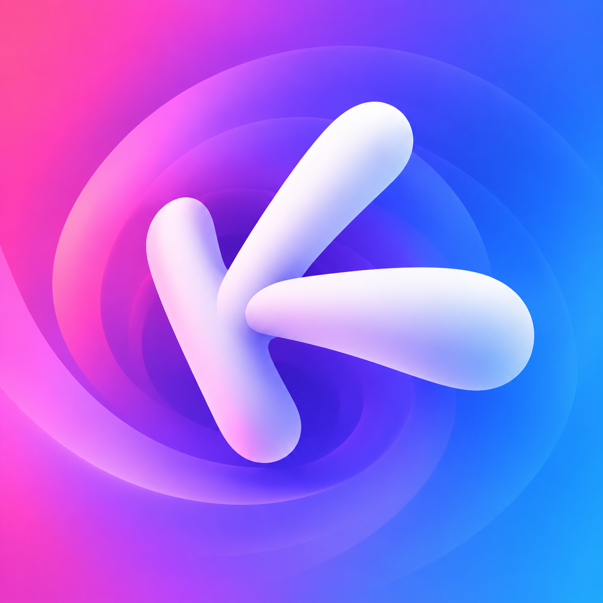
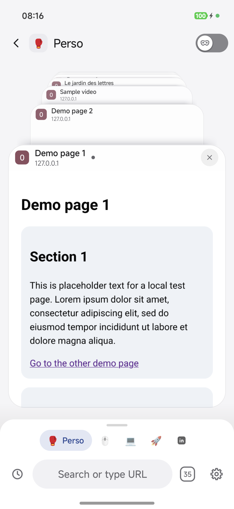
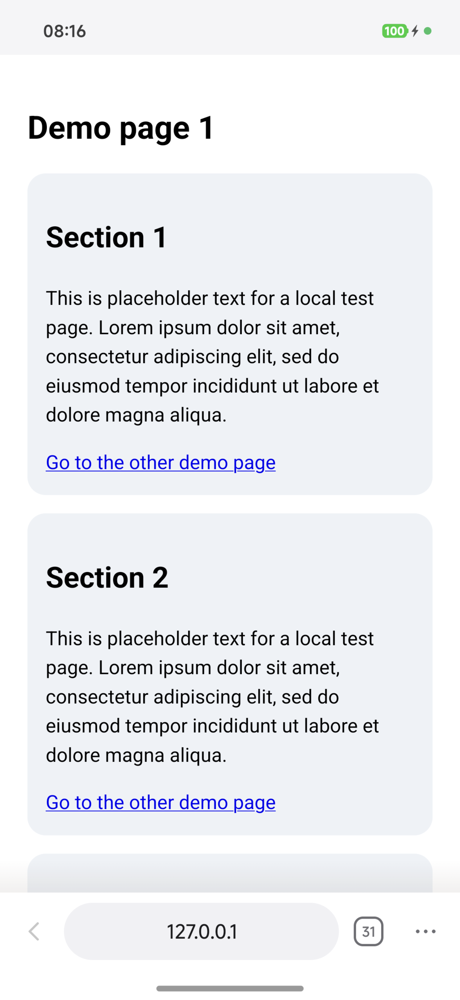
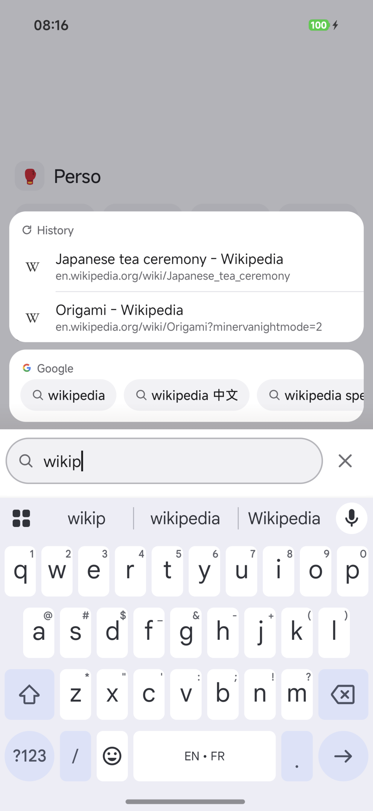
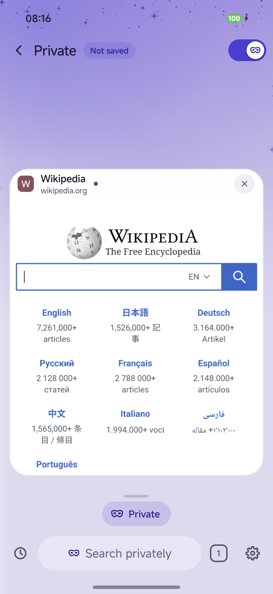
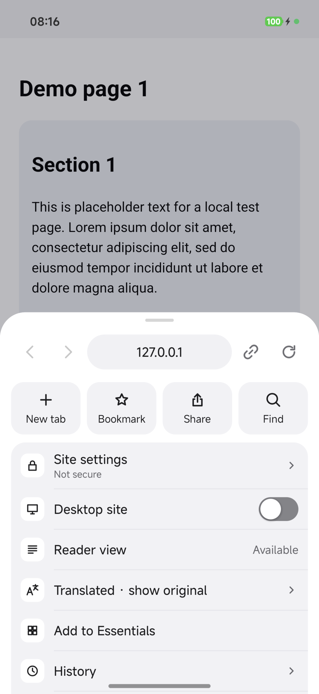
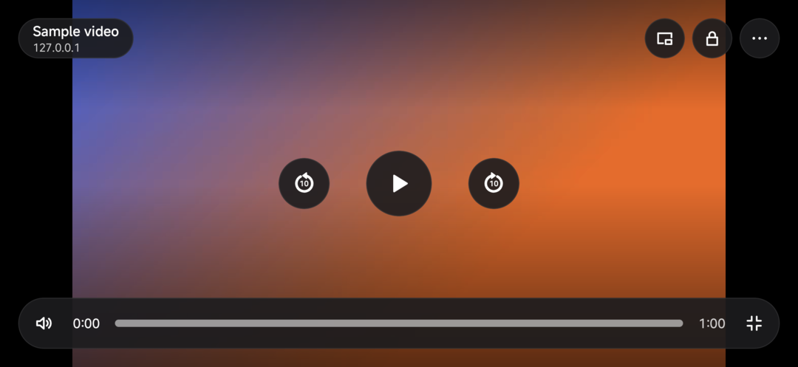

<p align="center"></p>

<h1 align="center">Koan</h1>

<p align="center">
  An Android browser built around <b>Zen Browser's Spaces</b>, on <b>GeckoView</b> (Firefox's engine).<br>
  Your Spaces, tabs, passwords and history from your Mozilla account, with a card stack of tabs and one-handed gestures.
</p>

<p align="center">
  <a href="https://github.com/Nerzouille/Koan/releases">Download</a> ·
  <a href="docs/FEATURES.md">User guide</a> ·
  <a href="docs/PRIVACY.md">Privacy</a> ·
  <a href="CHANGELOG.md">Changelog</a>
  <br><br>
  <a href="https://github.com/Nerzouille/Koan/actions/workflows/ci.yml"></a>
</p>

> Koan is not affiliated with, endorsed by or connected to Zen Browser or Mozilla.

**Beta.** Koan is used every day, but it is a small project: sideloaded only, no Play Store, no
support promise. Spaces are read-only; passwords and history can sync both ways if you turn it on.

## What Koan is

Zen Browser organises the desktop into **Spaces**: workspaces with their own tabs, pinned tabs,
essentials, folders, icon and colours. Koan brings those Spaces to an Android phone. It reads them
from the Firefox Sync account Zen already uses, and shows each Space as a stack of tab cards you
move through with your thumb.

It is a full browser on its own too: without an account it works with one local space.

## Features

- **Your Zen Spaces** as workspaces, with their essentials, pinned tabs and folders in a drawer.
  Hold the address pill and slide to change space.
- **A card stack of tabs** with depth: swipe the dock up for every tab of the space, sideways for
  the previous or next tab, a card away to close it (with Undo).
- **Search** with suggestions, inline completion, `@` shortcuts (`@yt`, `@wiki`…) and your own
  search engines; open tabs, history and bookmarks in the results.
- **Private browsing:** private tabs in their own set, locked behind your fingerprint after a
  minute away, no screenshots, no history, HTTPS only, tracking and fingerprinting protection,
  cleaner links. Private bookmarks are kept apart and encrypted on the phone.
- **Koan's own video player** for full-screen video: double-tap to skip, hold for 2×, swipe for
  brightness and volume, speed, lock; picture-in-picture with "Audio only".
- **Translation on the phone** (Firefox Translations): the page's text never leaves the phone.
- **Passwords and autofill** from your account and saved on the phone, behind your fingerprint.
- **Two-way sync, if you want it:** passwords saved on the phone and history can go back to your
  Mozilla account, each behind its own switch (off by default).
- **uBlock Origin**, downloads, find in page, reader view, site settings, Recently closed tabs,
  "Open in app" for links that have an app, and pages that fit around the dock and the keyboard.

Everything, screen by screen: [`docs/FEATURES.md`](docs/FEATURES.md).

## Screenshots

<!-- Light or dark follows the viewer's theme. Taken on a phone with demo pages. -->

| Tab stack | A page | Search |
|:---:|:---:|:---:|
| <picture><source media="(prefers-color-scheme: dark)" srcset="docs/media/overview-dark.png"></picture> | <picture><source media="(prefers-color-scheme: dark)" srcset="docs/media/page-dark.png"></picture> |  |
| **Private browsing** | **⋯ menu** | **Video player** |
| <picture><source media="(prefers-color-scheme: dark)" srcset="docs/media/private-dark.png"></picture> | <picture><source media="(prefers-color-scheme: dark)" srcset="docs/media/menu-dark.png"></picture> |  |

## Install

1. Download the APK from the [Releases page](https://github.com/Nerzouille/Koan/releases)
   (`koan-vX.Y.Z.apk`, about 217 MB) and open it. Android asks you to allow installs from your
   browser or file manager the first time.
2. Optional: check the file against the SHA-256 in the release notes:
   `sha256sum koan-vX.Y.Z.apk`.
3. Open Koan and sign in with your Mozilla account (on Mozilla's own page, or by scanning the code
   Zen shows on your computer), or skip it and just browse.

**Requirements:** Android 11 or newer (tested on Android 14 and 17), a 64-bit ARM phone
(arm64-v8a).

**Updates:** Settings › About Koan checks GitHub when you open it. To get updates automatically,
add `https://github.com/Nerzouille/Koan` to [Obtainium](https://github.com/ImranR98/Obtainium);
turn on its **Include prereleases** option while Koan's releases are betas. Installing over a
previous version keeps your tabs, spaces, logins and settings.

## Privacy

Koan has no account of its own, no server, no analytics, no telemetry, no ads and no crash
reporting.

- Your tabs, history, bookmarks, downloads and settings stay on the phone. Passwords and the
  Mozilla account keys are encrypted with a key held by Android's Keystore.
- Sign-in and sync talk only to **Mozilla's servers**. Sync data is end-to-end encrypted.
- Koan writes to your account only what you turn on (passwords saved on the phone, history).
  **Spaces, tabs and bookmarks are never written.**
- The other requests are the ones any browser makes: your search engine, site icons, uBlock
  Origin's filter lists, Firefox's own lists, and GitHub's releases feed when you open About.

Every network request Koan makes, and why: [`docs/PRIVACY.md`](docs/PRIVACY.md).

### Sign-in caveat

To be allowed into Firefox Sync, Koan's sign-in **identifies as Firefox** (desktop, or Android
when you sign in from your computer). This is unofficial: it can break whenever Mozilla changes
something, and it may go against Mozilla's terms of service. **Use it at your own risk**, ideally
not with an account you can't afford to have trouble with.

## Build

Requirements: JDK 17 and the Android SDK (platform 37.2; Android Studio or the command-line tools).

```sh
git clone https://github.com/Nerzouille/Koan.git
cd Koan
./gradlew assembleDebug              # app/build/outputs/apk/debug/
./gradlew testDebugUnitTest          # JVM unit tests (Robolectric for Room, DataStore and sync)
```

The sync layer is checked against [Z-Sync](https://github.com/Kjell6/Z-Sync)'s golden contract
fixtures, read in place from a local checkout (gitignored, never modified). Without it, those tests
are skipped:

```sh
git clone --depth 1 https://github.com/Kjell6/Z-Sync.git reference/Z-Sync
```

**Release build** (R8 on; judge animations on this one): `./gradlew assembleRelease`. It signs with
the key named in a `keystore.properties` file at the repo root (gitignored, keystore kept outside
the repo):

```properties
storeFile=/path/to/your-release.jks
storePassword=…
keyAlias=…
keyPassword=…
```

Without that file, the release build is signed with the debug key so that it still installs.

**Baseline profile:** `app/src/main/generated/baselineProfiles/` is generated on a connected phone
(Android 13+) with `./gradlew :app:generateBaselineProfile`. It drives its own copy of the
app (`dev.nerzouille.koan.bp`), never an installed Koan.

CI ([`.github/workflows/ci.yml`](.github/workflows/ci.yml)) runs the unit tests and a debug build on
every push and pull request to `dev` and `main`.

## Feedback

Found a bug or have an idea? Open an issue:
[bug report](https://github.com/Nerzouille/Koan/issues/new?template=bug_report.yml) (phone model,
Android version, Koan version from Settings › About Koan, what happened) or
[feature request](https://github.com/Nerzouille/Koan/issues/new?template=feature_request.yml).
Please leave private things out of issues: account emails, real tabs, passwords.

## Credits

- [Z-Sync](https://github.com/Kjell6/Z-Sync) by Kjell Behrends (MIT): the sync, crypto, Mozilla
  sign-in and favicon code is ported from it, and its contract is what makes reading Zen Spaces
  possible.
- [Zen Browser](https://github.com/zen-browser/desktop): the Spaces concept, and the space and
  folder icons (MPL 2.0, most of them [Ionicons](https://ionic.io/ionicons) glyphs).
- [Tabler Icons](https://tabler.io/icons) (MIT) and the [Zia](https://github.com/z1n-k/zia) mod
  (MIT): the icons, and Zia's Phosphor-to-Tabler table for space icons picked with Zia.
- [GeckoView and Mozilla Android Components](https://github.com/mozilla-firefox/firefox) (MPL 2.0).

Firefox and Mozilla are trademarks of the Mozilla Foundation. Zen Browser is an independent project.

## Licence

Koan's own code is under the [MIT licence](LICENSE). Third-party parts keep their own licences:
[`THIRD_PARTY_NOTICES.md`](THIRD_PARTY_NOTICES.md).
